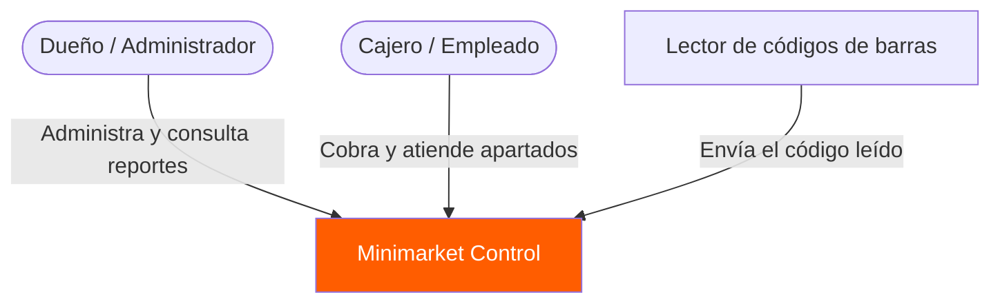
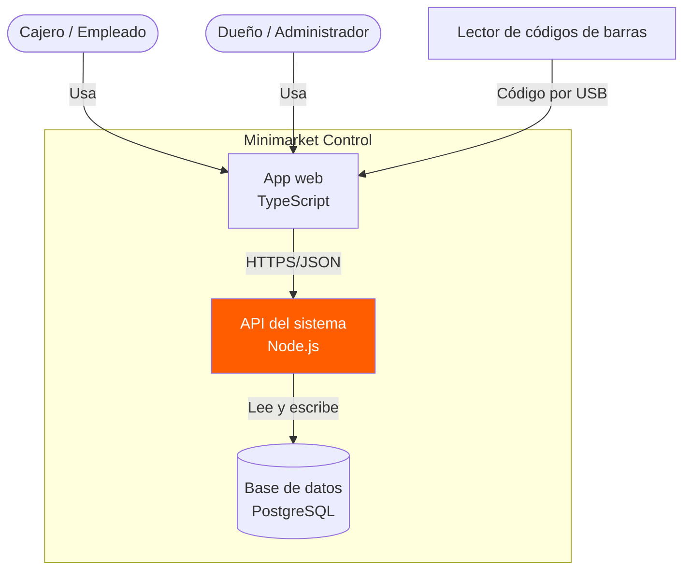
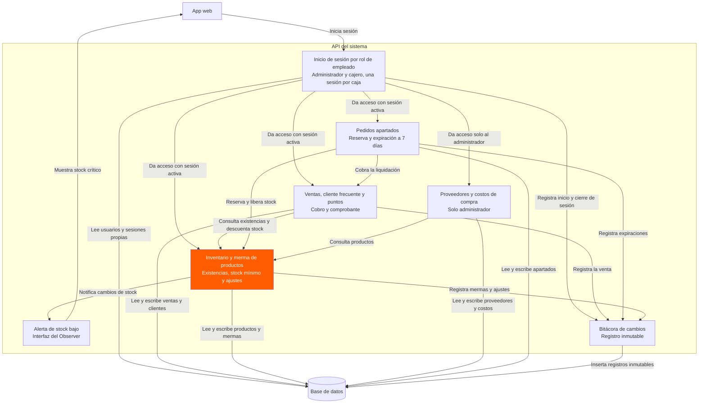
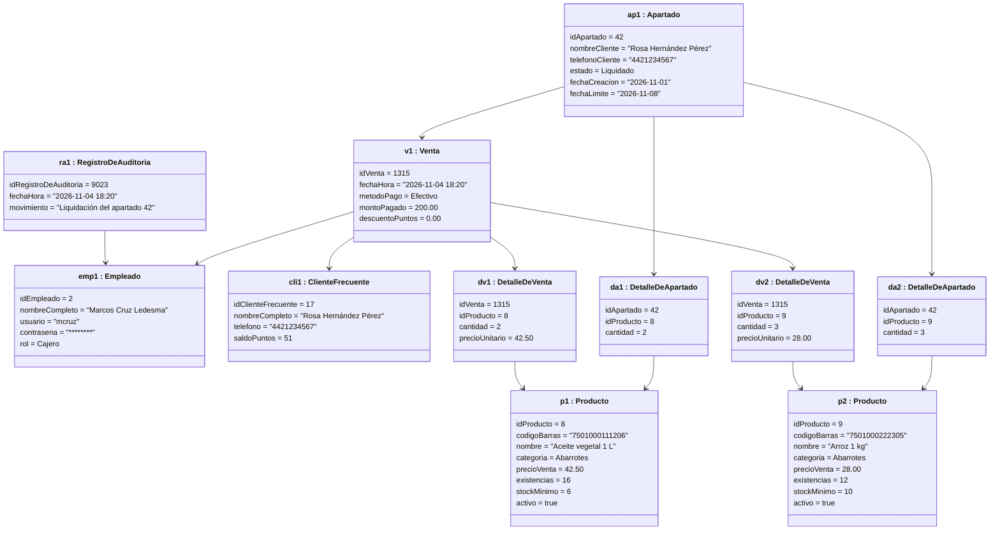
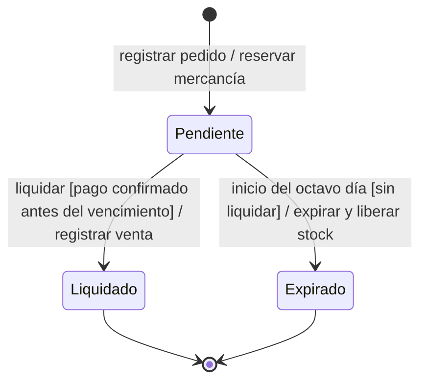

# Diagramas de arquitectura: Minimarket Control

## Diagrama 1: Contexto C4 (nivel 1)



**Frontera:** Administrador y Cajero son actores externos; el lector USB es un periférico externo, no un servicio web. No se requiere una pasarela de pagos ni otros sistemas externos en el alcance actual.

## Diagrama 2: Contenedores C4 (nivel 2)



**Despliegue previsto:** Aplicación web TypeScript, API Node.js y PostgreSQL comparten la red de la tienda. Las tres cajas acceden al mismo inventario mediante la API; el hardware lector se conecta por USB al equipo de caja.

## Diagrama 3: Componentes C4 de la API (nivel 3, monolito modular)



Cada módulo accede únicamente a sus datos; la comunicación entre módulos se realiza por interfaces. El módulo **Pedidos apartados** es el punto de modificación propuesto por SC-001, pero la consulta nueva no forma parte del diseño vigente mientras siga en propuesta.

## Diagrama 4: Clases UML (diseño vigente)

```mermaid
classDiagram
    class Producto {
        -idProducto: int
        -codigoBarras: String
        -nombre: String
        -categoria: String
        -precioVenta: decimal
        -existencias: int
        -stockMinimo: int
        -activo: boolean
        +hayDisponibilidad(unidades: int) boolean
        +descontar(unidades: int) void
        +reponer(unidades: int) void
        +ajustarStock(nuevaCantidad: int, motivo: String) void
        +modificarDatos(nombre: String, categoria: String, precioVenta: decimal, stockMinimo: int) void
        +darDeBaja() void
        +estaEnStockCritico() boolean
    }

    class Proveedor {
        -idProveedor: int
        -nombreComercial: String
        -telefono: String
        -direccion: String
        +asignarCosto(producto: Producto, costoUnitario: decimal) CostoDeCompra
    }

    class CostoDeCompra {
        -idCostoDeCompra: int
        -idProveedor: int
        -idProducto: int
        -costoUnitario: decimal
        -fechaRegistro: Date
        +compararCon(otro: CostoDeCompra) int
    }

    class ClienteFrecuente {
        -idClienteFrecuente: int
        -nombreCompleto: String
        -telefono: String
        -saldoPuntos: int
        +acumularPuntos(importeCobrado: decimal) void
        +canjearPuntos(puntos: int, equivalencia: decimal) decimal
        +consultarSaldo() int
    }

    class Empleado {
        -idEmpleado: int
        -nombreCompleto: String
        -usuario: String
        -contrasena: String
        -rol: Rol
        +iniciarSesion(contrasena: String) boolean
        +cerrarSesion() void
        +esAdministrador() boolean
    }

    class Rol {
        <<enumeration>>
        Administrador
        Cajero
    }

    class Venta {
        -idVenta: int
        -fechaHora: DateTime
        -metodoPago: String
        -montoPagado: decimal
        -descuentoPuntos: decimal
        +agregarProducto(producto: Producto, cantidad: int) DetalleDeVenta
        +calcularTotal() decimal
        +aplicarCanje(descuento: decimal) void
        +validarPago() boolean
        +calcularCambio() decimal
        +confirmar() boolean
        +emitirComprobante() String
    }

    class DetalleDeVenta {
        -idVenta: int
        -idProducto: int
        -cantidad: int
        -precioUnitario: decimal
        +calcularImporte() decimal
    }

    class Apartado {
        -idApartado: int
        -nombreCliente: String
        -telefonoCliente: String
        -estado: EstadoApartado
        -fechaCreacion: Date
        -fechaLimite: Date
        +reservar() void
        +liquidar(telefonoPuntos: String) Venta
        +expirar() void
        +estaVigente() boolean
    }

    class EstadoApartado {
        <<enumeration>>
        Pendiente
        Liquidado
        Expirado
    }

    class DetalleDeApartado {
        -idApartado: int
        -idProducto: int
        -cantidad: int
        +liberar() void
    }

    class Merma {
        -idMerma: int
        -cantidad: int
        -motivo: String
        -fechaHora: DateTime
        +validar() boolean
        +aplicarAlInventario() void
    }

    class RegistroDeAuditoria {
        <<inmutable>>
        -idRegistroDeAuditoria: int
        -fechaHora: DateTime
        -movimiento: String
        -actor: String
        +crear(movimiento: String, actor: String): RegistroDeAuditoria
    }

    Venta "1" *-- "1..*" DetalleDeVenta : contiene
    Apartado "1" *-- "1..*" DetalleDeApartado : reserva

    DetalleDeVenta "*" --> "1" Producto : es de
    DetalleDeApartado "*" --> "1" Producto : reserva

    CostoDeCompra "*" --> "1" Proveedor : ofrecido por
    CostoDeCompra "*" --> "1" Producto : de

    Venta "*" --> "1" Empleado : atendida por
    Venta "*" --> "0..1" ClienteFrecuente : identifica a

    Apartado "0..1" --> "0..1" Venta : se liquida en

    Merma "*" --> "1" Producto : descuenta de
    Merma "*" --> "1" Empleado : registrada por

    RegistroDeAuditoria "*" --> "0..1" Empleado : hecho por

    note for Venta "Total a pagar = suma de (cantidad × precioUnitario) de cada DetalleDeVenta − descuentoPuntos"

    note for DetalleDeVenta "idVenta e idProducto identifican la fila. El precioUnitario se copia de Producto.precioVenta al agregar el producto."

    note for DetalleDeApartado "idApartado e idProducto identifican la fila. Registra la cantidad de unidades reservadas."

    note for CostoDeCompra "idCostoDeCompra identifica cada registro histórico. Los mismos proveedor y producto pueden tener costos registrados en distintas fechas."

    note for RegistroDeAuditoria "Se crea una sola vez y no puede modificarse ni eliminarse. actor es Empleado con ID o Sistema para procesos automáticos."
```



**Concordancia con secuencia y estados:** `Venta.confirmar()`, `Producto.hayDisponibilidad()`, `Producto.descontar()`, `ClienteFrecuente.acumularPuntos()`, `RegistroDeAuditoria.crear()` y `Venta.emitirComprobante()` aparecen como operaciones que reciben los mensajes del diagrama 6. `Apartado.estado: EstadoApartado` toma exactamente los valores `Pendiente`, `Liquidado` y `Expirado` del diagrama 7.

**Restricción:** Los detalles de venta y apartado contienen el precio unitario de la venta (histórico de lo cobrado) y la cantidad reservada, respectivamente. En `CostoDeCompra` se conserva historial por fecha y registro propio.

## Diagrama 5: Objetos UML (ejemplo de apartado liquidado)




**Interpretación:** Es una instantánea de un apartado liquidado el 4 de noviembre de 2026, antes de su fecha límite. Mermaid lo representa mediante `classDiagram` porque no incorpora un tipo nativo de diagrama de objetos; cada nodo denota una instancia concreta del tipo indicado.

## Diagrama 6: Secuencia UML del caso de uso principal CU-01 (registrar venta)

```mermaid
sequenceDiagram
    actor Cajero
    participant Web as Aplicación web
    participant Venta
    participant Producto
    participant ClienteFrecuente
    participant RegistroDeAuditoria

    Cajero->>Web: Escanear producto e indicar cantidad
    Web->>+Venta: agregarProducto(producto, cantidad)
    Venta->>+Producto: hayDisponibilidad(cantidad)
    Producto-->>-Venta: disponibilidad
    Venta-->>-Web: DetalleDeVenta o aviso de stock

    Cajero->>Web: Confirmar cobro
    Web->>+Venta: validarPago()
    Venta-->>-Web: pagoValido
    Web->>+Venta: confirmar()
    Note over Venta,Producto: Revalidación y descuento atómicos antes de confirmar
    Venta->>+Producto: hayDisponibilidad(cantidad)
    Producto-->>-Venta: disponibilidadActual

    alt Existencias suficientes y pago válido
        Venta->>+Producto: descontar(cantidad)
        Producto-->>-Venta: existenciasActualizadas
        opt Cliente frecuente identificado
            Venta->>+ClienteFrecuente: acumularPuntos(importeCobrado)
            ClienteFrecuente-->>-Venta: puntosActualizados
        end
        Venta->>+RegistroDeAuditoria: crear(movimiento, actor)
        RegistroDeAuditoria-->>-Venta: registroInmutable
        Venta-->>-Web: ventaConfirmada
        Web->>+Venta: emitirComprobante()
        Venta-->>-Web: comprobante
        Web-->>Cajero: Mostrar comprobante en pantalla
    else Stock insuficiente o pago inválido
        Venta-->>-Web: ventaRechazada
        Web-->>Cajero: Mostrar motivo y permitir corregir
    end
```

**Correspondencia obligatoria:** El mensaje `Venta → Producto: descontar(cantidad)` se corresponde exactamente con `Producto.+descontar(unidades: int): void` en el diagrama de clases; `Venta → RegistroDeAuditoria: crear(movimiento, actor)` se corresponde con `RegistroDeAuditoria.+crear(movimiento: String, actor: String)`. La aplicación web es el contenedor de interfaz del diagrama C4 y no una clase del dominio. El caso de uso prevé validar nuevamente el stock al confirmar el cobro para evitar ventas simultáneas con existencias insuficientes (FA-01.9).

**Hueco detectado al elaborar la secuencia:** La clase `RegistroDeAuditoria` no exponía una operación para crear el asiento. Se añadió `crear(movimiento, actor)` y se ajustó a `0..1` la asociación con `Empleado`, pues RF-016 genera expiraciones automáticas sin una sesión de cajero.

## Diagrama 7: Estados UML del pedido Apartado



**Concordancia con clases:** `Apartado` contiene el atributo privado `estado: EstadoApartado`, cuyo enumerado incluye exactamente `Pendiente`, `Liquidado` y `Expirado`. Los eventos `liquidar` y `expirar` corresponden a sus operaciones `+liquidar(...)` y `+expirar()`. La fecha límite no cambia por la consulta propuesta en SC-001; por ello el diagrama de estados **no necesita modificarse** para ese cambio.

**Nota:** La consulta de apartados próximos a vencer solicitada en SC-001 no es un estado nuevo: filtra apartados que siguen en `Pendiente` según `fechaLimite`. Su diseño propuesto, sin alterar el modelo vigente, se documenta en `AI-001-analisis-de-impacto-SC-001.md`.
